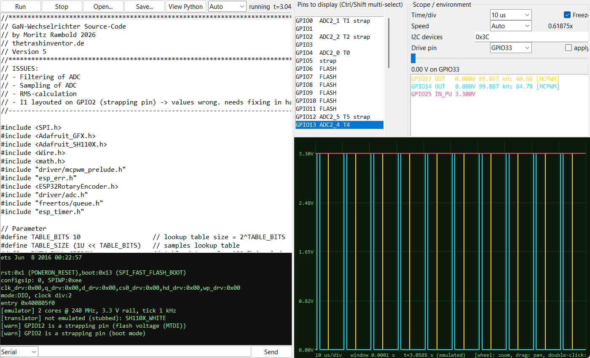

# ESP32 Emulator

A universal, Python-based ESP32 emulator with a virtual oscilloscope. Paste or open an **Arduino C++ sketch (`.ino`)** or a **Python script**, press *Run*, and watch the voltage of any GPIO pin.



*A 3-channel 100 kHz MCPWM inverter sketch running at 10 µs/div.*

## Features

- **Runs real Arduino C++ sketches** (`setup()`/`loop()` or `app_main()`), translated to Python by `esp32_cpp.py`. The same API is also available directly in Python.
- **Oscilloscope for every pin**: multi-select pins, exact edge rendering, alias-free display of dense waveforms (per-pixel average + min/max band), mouse-wheel zoom down to 100 ns, drag to pan, freeze.
- **Hardware-like behaviour**: GPIO rules (input-only, flash and strapping pins), pull-ups, VIL/VIH thresholds, interrupts, ADC (12 bit, attenuation, noise), DAC, touch, LEDC PWM, MCPWM, hardware timers, `esp_timer`, FreeRTOS tasks on 2 cores, UART (bit-exact TX waveform), I²C with virtual devices, basic SPI.
- **Emulated clock** with adjustable speed. Very fast events (e.g. 100 kHz PWM interrupts) run in slow motion; *Auto* mode adapts the speed to your PC.
- **Drive inputs** with a slider (0–3.3 V) to feed ADC pins, buttons and interrupts.
- Serial console with input line; ESP32-style boot banner and "Guru Meditation" panics with the failing line.

## Quick start

Requirements: Python 3.9+ with tkinter. `numpy` is optional but recommended (exact scope rendering).

```bash
pip install -r requirements.txt   # optional: numpy
python ESP32_Simulator.py
```

Keep `ESP32_Simulator.py` and `esp32_cpp.py` in the same folder. Click **Open…** to load a sketch (or edit the built-in example) and press **Run**.

### Example

```cpp
#define LED 2
void setup() { pinMode(LED, OUTPUT); Serial.begin(115200); }
void loop()  { digitalWrite(LED, HIGH); delay(100); digitalWrite(LED, LOW); delay(100); Serial.println("blink"); }
```

Select GPIO2 in the pin list to see the square wave.

## Scope controls

| Action | Effect |
|---|---|
| Mouse wheel | Zoom the time axis |
| Drag | Pan through history (pauses the view) |
| Double-click | Back to live |
| Time/div, Freeze | Set the window directly / pause |

## Limitations

- Behavioural, **not instruction-level** emulation: code between hardware events takes almost no emulated time.
- Not emulated: Wi-Fi, Bluetooth, USB, Ethernet, SD, I²S, RMT, CAN, camera.
- C++ translator does not support classes with methods, templates, lambdas, `new`/`delete`, `goto` or namespaces. References/pointers to plain scalars are by value (except `&x` out-parameters).
- Third-party library objects (OLED displays, rotary-encoder classes, …) are dummies: calls succeed but do nothing. Unknown names are listed as `[translator] not emulated`.

## Documentation

See [docs/ESP32_Simulator_Documentation.pdf](docs/ESP32_Simulator_Documentation.pdf) for the full manual (UI, timing model, supported hardware, workflows, troubleshooting).

## Project layout

| File | Purpose |
|---|---|
| `ESP32_Simulator.py` | Chip model, event engine, peripherals and tkinter GUI |
| `esp32_cpp.py` | C++-subset → Python translator |
| `docs/` | Manual and screenshot |

## License

No license has been chosen yet. Add a `LICENSE` file before publishing if you want others to reuse the code.
